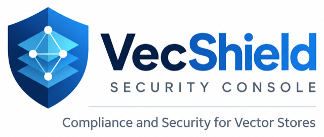

  

# VecShield brand

The mark is a shield split down the centre, holding three stacked layers with a
graph drawn over them: a vector store is a **stack** of collections, its
contents are **related** rather than filed, and the whole thing sits behind a
**shield**. The two-tone split is the signature — a single-colour shield is a
different logo.

## Assets

| File | What it is | Where it is used |
|---|---|---|
| `vecshield-mark.png` | The mark, transparent background, 1254px | Source for icons and favicons |
| `vecshield-app-icon.png` | The mark on a rounded blue tile, 1254px | Source for app/touch icons |
| `vecshield-logo-lockup.png` | Mark + wordmark + tagline, cropped to its content | READMEs, decks, documents |

Derived files that ship with the console live in
`vecshield_platform/api/dashboard/dist/assets/`:

| File | Purpose |
|---|---|
| `vecshield-mark.svg` | The favicon and the sidebar logo. Hand-drawn SVG, so it stays crisp at 16px, weighs ~2KB and needs no build step |
| `vecshield-mark-192.png` | PNG favicon fallback |
| `vecshield-app-icon-180.png` | `apple-touch-icon` |
| `vecshield-logo.png` | The lockup, for the console's Docs page (`#/docs`) |

The SVG is the canonical mark for anything on screen. Regenerate the PNGs from
the sources above (`sips -Z <size> in.png --out out.png`) rather than from the
SVG, so the rounded tile keeps its own artwork.

## Palette

Sampled from the artwork, then checked against WCAG before being adopted as
tokens. `api/dashboard/tests/contrast.test.mjs` fails the build if a pairing
drops below its bar, so these values are not free to drift.

| Token | Light | Role |
|---|---|---|
| `--brand-900` | `#031e46` | The wordmark's "Vec"; the sidebar |
| `--brand-800` | `#072a5e` | — |
| `--brand-700` | `#0b3f86` | The shield's left half; the active nav item |
| `--brand-600` | `#0e65ca` | The wordmark's "Shield"; **the accent** (4.9:1 on the lightest surface it is allowed on) |
| `--brand-500` | `#0184fc` | The shield's right half |
| `--brand-400` | `#19b6fc` | The top layer |
| `--brand-50` | `#e8f0fd` | Accent wash |

In dark mode the accent lifts to `#4ea8ff`, and the whole theme sits in one
navy: `--brand-night` (`#01152f`) is both the sidebar **and** the page
background, with `--surface` (`#08233f`), `--surface-2` (`#0c2a49`) and
`--surface-3` (`#143659`) climbing out of it. Because the sidebar and the page
then share a colour, the sidebar draws its own right border in dark mode
(`--side-edge`). All of it is checked by the same gate.

Two dark-mode rules follow from those values:

- **Text on the accent is navy, not white.** White on `#4ea8ff` is 2.5:1, so
  in dark mode `--accent-ink` is `--brand-night` (7.3:1) and a hovered primary
  button lightens to `--brand-400` rather than darkening. Light mode keeps
  white on `--brand-600`.
- **The current sidebar item is marked by a bar, not by fill alone.**
  `--side-indicator` (`--brand-400`, the mark's top layer) draws a 3px bar on
  the current nav item over `--side-active`, and the item's label goes to
  weight 600. The contrast gate holds the bar at 3:1 or better against both
  the sidebar and the active fill, in both themes.

The console follows the operating system's colour scheme until someone picks
a theme with the header toggle; that choice is remembered in the browser.

**`--low` is cyan (`#0d6e8c`), not blue.** Severity is its own scale and must
not be mistaken for chrome: a blue "low" badge beside a blue accent reads as a
link. Severity also always carries an icon and a label, so it never depends on
colour alone.

## Typography

The console sets its text in **Inter** and its identifiers, hashes and code in
**JetBrains Mono**. Both are self-hosted under the SIL Open Font License from
`vecshield_platform/api/dashboard/dist/assets/fonts/` (the console's CSP
allows only same-origin files), as Latin subsets of the variable fonts cut to
weights 400–600. The fonts folder's README records the upstream versions,
checksums and the commands that produced the subsets.

- **Scale**, five steps: 11 / 13 / 14 / 16 / 24px (`--text-xs` … `--text-xl`).
  Body text is 14px; page titles are 24px.
- **Weights**, three: 400 for body text, 500 for controls, labels and table
  headers, 600 for headings, figures and the current item.
- **Case**: labels are sentence case. Only the product line under the
  wordmark and the sidebar's group headings are uppercase and tracked.
- Inter's `cv05` and `cv08` alternates are on, so `I`, `l` and `1` stay
  distinct in IDs, and counts use tabular figures.

## Wordmark

"VecShield" is one word, capital V and capital S. The console's sidebar sets
the product line beneath it in uppercase at 11px (`--text-xs`, the smallest
step of the type scale) with `.06em` tracking. It used to be 10.5px; the type
scale test now allows only the five steps, so 11px is the floor.

The lockup in `vecshield-logo-lockup.png` reads "VecShield · Security Console ·
Compliance and Security for Vector Stores". The product is framed in-app as
**Privacy & Compliance**; if the lockup should be reissued to match, that is a
deliberate call to make on the artwork rather than a mismatch to paper over in
CSS.

## Small sizes

The mark carries three layers and a four-node graph. Below about 36px those
merge into one white shape, so the graph is drawn lighter than the source
artwork — thinner strokes, smaller nodes, pulled slightly inward — and the
console's sidebar renders it at 40px rather than the 34px a generic logo slot
would get. Check any new size against a navy background before shipping it.

## Using it

- On light backgrounds the mark stands alone; it needs no container or tile.
- On the navy sidebar the mark also stands alone — its left half is lighter
  than `--brand-900` precisely so it stays legible there.
- Do not recolour the mark, put it in a circle, or add a drop shadow.
- Clear space: at least the width of one shield shoulder on every side.
